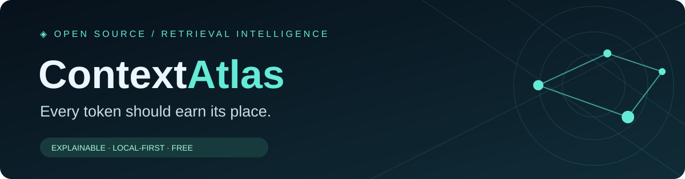
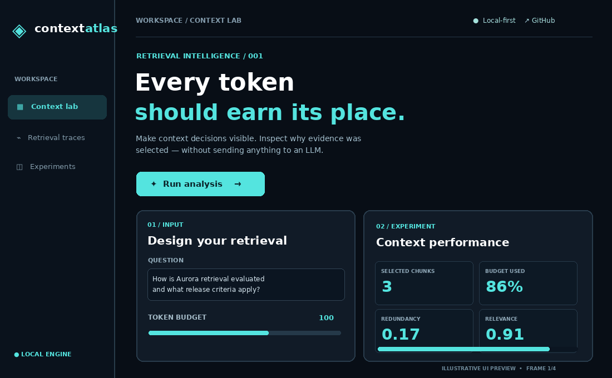

<div align="center">



# ContextAtlas

**An explainable context-budget laboratory for retrieval-augmented generation.**

[](https://github.com/tejas-sarnaik/ContextAtlas/actions/workflows/ci.yml)
[](pyproject.toml)
[](LICENSE)
[](SECURITY.md)

**No API keys · No paid models · No tracking · Inspectable decisions**

[Quickstart](#-quickstart) · [Features](#-features) · [Algorithm](#-how-it-works) · [API](#-python-api) · [Research](#-research-notes) · [Contributing](CONTRIBUTING.md)

</div>

## ⚡ The 30-second demo



> The GIF is an illustrative animation of the local UI layout (not a captured browser session); displayed example metrics are mock values. The software is a reproducible research prototype, **not** a model that generates answers or guarantees accuracy gains.

## Why it exists

Retrieval pipelines frequently send redundant passages to language models, use arbitrary top-*k* cutoffs, and make it hard to inspect *why* a chunk earned a place in the prompt. ContextAtlas exposes the selection decision: estimated cost, relevance, overlap, query-term coverage, accepted and rejected chunks, and a naive comparison under the **same** budget.

### ✨ Features

| Capability | What you get |
|---|---|
| **Interactive context lab** | Dark, responsive dashboard with editable queries, chunks, sliders and live comparisons |
| **Token budget sandbox** | Constraints enforced using explicitly approximate lexical token counts |
| **BM25 retrieval signal** | Deterministic ranking, entirely local |
| **Diversity-aware packing** | Greedy marginal-utility heuristic balances relevance, novelty and redundancy |
| **Inspectable decisions** | Per-chunk score, source label, matched terms and explanation |
| **Baseline comparison** | Top-relevance fit-aware packing vs ContextAtlas under an identical budget |
| **Copy-ready evidence** | Assemble source-labeled context for a downstream LLM (no model calls are made) |
| **Python + CLI + JSON API** | Integrate selections in experiments and pipelines |
| **No runtime Python dependencies** | Standard-library server and algorithm; optional fonts are loaded from Google Fonts |

## 🚀 Quickstart

Requirements: **Python 3.10+**.

```bash
git clone https://github.com/tejas-sarnaik/ContextAtlas.git
cd ContextAtlas
python -m contextatlas serve
```

Open **http://127.0.0.1:8765**. The demo dataset automatically loads, and you can replace every chunk with your own local JSON input.

Install a named CLI command (optional):

```bash
python -m pip install -e .
contextatlas serve
```

Run the CLI experiment without launching the UI:

```bash
python -m contextatlas analyze datasets/demo.json --budget 100 --output outputs.json
```

## 🧪 Python API

```python
from contextatlas import analyze

result = analyze(
    query="How is Aurora evaluated?",
    chunks=[
        {"id": "doc-1", "source": "Evaluation", "text": "Aurora is evaluated with Recall@5 and MRR."},
        {"id": "doc-2", "source": "Design", "text": "Aurora has a dark UI with teal buttons."},
    ],
    budget=25,
    diversity=0.6,
)
print(result["optimized_metrics"])
print(result["assembled_context"])
```

### HTTP API

The local server exposes `GET /api/health`, `GET /api/demo`, and `POST /api/analyze`:

```bash
curl -s http://127.0.0.1:8765/api/analyze \
  -H 'Content-Type: application/json' \
  -d '{"query":"What is Aurora?","budget":50,"diversity":0.5,"chunks":[{"id":"1","source":"note","text":"Aurora is a hybrid retrieval pipeline."}]}'
```

Limits: up to 300 chunks, 250 KB request bodies, and budgets from 1 to 100,000 approximate tokens.

## 🧠 How it works

1. Normalize and tokenize each chunk, compute BM25 similarity to the query.
2. Normalize relevance by the largest candidate score.
3. Build a fit-aware top-relevance baseline under the same budget.
4. Select the next fitting passage by a cost-adjusted, redundancy-aware score.
5. Explain every selected chunk and produce source-labeled evidence.

For candidate passage \(c\), selected set \(S\), query-token set \(Q\), and remaining token budget \(B\), the selection heuristic is

\[
U(c\mid S)=\frac{\widehat{\mathrm{BM25}}(c,Q)+0.35\,\mathrm{newCoverage}(c,Q,S)-\lambda\max_{s\in S}J(c,s)}{\sqrt{\widehat{T}(c)}}
\]

where \(J\) is set Jaccard overlap, \(\widehat{T}\) an **approximate** lexical token count, and \(\lambda\in[0,1]\) the chosen diversity pressure. The algorithm greedily picks the highest positive-utility fitting candidate. This is **not** an exact knapsack optimizer or a new theoretically proven retrieval method.

### Compare responsibly

The dashboard reports token utilization, normalized relevance and mean pairwise overlap. These descriptive statistics do **not** prove answer quality improvements, factuality or real API cost savings. Proper evaluation needs a held-out labeled retrieval set, a model-specific tokenizer, and downstream answer metrics.

## 🗂 Repository layout

```text
ContextAtlas/
├── assets/                    # Branded SVG banner and animated README GIF
├── contextatlas/
│   ├── __init__.py
│   ├── __main__.py
│   ├── cli.py                 # CLI entry point
│   ├── engine.py              # BM25 + selection + diagnostics
│   └── server.py              # Loopback HTTP server and API
├── datasets/demo.json        # Self-contained example corpus
├── examples/                 # Programmatic quickstart
├── tests/test_engine.py      # Automated tests
├── web/
│   ├── index.html            # Product dashboard
│   ├── styles.css
│   └── app.js
├── .github/workflows/ci.yml
├── .github/ISSUE_TEMPLATE/
├── README.md
├── LICENSE
├── CITATION.cff
├── CHANGELOG.md
├── ROADMAP.md
├── CONTRIBUTING.md
├── SECURITY.md
└── pyproject.toml
```

## 🔬 Research notes

Context selection is an active research area; [RepoDistill (ACL 2026)](https://aclanthology.org/2026.findings-acl.217/) and [CORE-RAG (ICML 2026)](https://proceedings.mlr.press/v306/cui26i.html) are examples of related work. The current project combines established signals into an explainable interactive prototype; it **does not claim a wholly new algorithm**. See [ROADMAP.md](ROADMAP.md) for planned exact tokenizer integration, evaluation datasets, constrained optimization and controlled benchmarks.

### Run tests

```bash
python -m unittest discover -s tests -v
```

## ❤️ Issues and contributions

Bug reports, feature requests and suggestions are welcome. Please [open an issue](https://github.com/tejas-sarnaik/ContextAtlas/issues) and read [CONTRIBUTING.md](CONTRIBUTING.md).

## 📜 License

Licensed under the [MIT License](LICENSE).

## ✉️ Contact

Questions or issues? [Open an issue](https://github.com/tejas-sarnaik/ContextAtlas/issues) or contact [Tejas Sarnaik](mailto:tejassarnaik2120@gmail.com).

---

<div align="center"><sub>© 2026 Tejas Sarnaik. All rights reserved. Licensed under MIT.</sub></div>
